<div align="center">

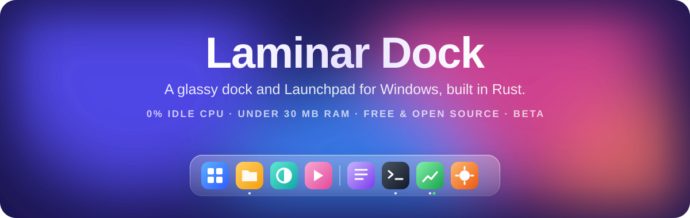

<br>

[](https://github.com/davesousa/Laminar_Dock/releases/latest)
[](https://github.com/davesousa/Laminar_Dock/releases)
[](LICENSE)
[](https://www.rust-lang.org/)
[](#-install)

**A dock and Launchpad that replace the Windows taskbar.**<br>
The polish of a Mac dock, the habits of Windows, and the footprint of a tiny native app.

[**⬇ Download for Windows**](https://github.com/davesousa/Laminar_Dock/releases/latest/download/LaminarDock-win-Setup.exe) &nbsp;·&nbsp;
[Report a bug](https://github.com/davesousa/Laminar_Dock/issues/new) &nbsp;·&nbsp;
[Contribute](#-contributing) &nbsp;·&nbsp;
[Dev log](docs/DEVELOPMENT.md)

<br>

<picture>
  <source media="(prefers-color-scheme: light)" srcset="docs/media/dock-magnify-light.gif">
  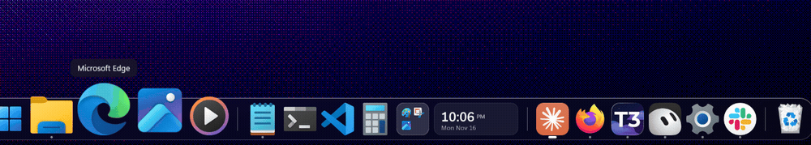
</picture>

</div>

<br>

> [!IMPORTANT]
> **Laminar is in beta.** It's the daily taskbar on its author's PCs, but it has bugs and rough edges, and it has only been tested on a few machines. That's where you come in: [**tell us what breaks**](https://github.com/davesousa/Laminar_Dock/issues/new), and if you can fix it, [**send a pull request**](#-contributing). Every report makes the next release better.

## ⚡ Light enough to forget it's running

Laminar is a native Rust app that draws with the same GPU compositor Windows uses for its own shell. There's no browser engine, no .NET runtime and no Electron. When you aren't touching it, it does nothing at all.


<details>
<summary><b>How these were measured</b></summary>
<br>

Measured on 2026-11-16 with release 0.2.5 on Windows 11 (build 26200, Ryzen 7 3700X, RTX 3070 Ti, 1920×1080 main display). The app has a built-in benchmark, `laminar.exe --measure`, which starts a test dock, waits 10 seconds with no input, then sweeps a simulated pointer across it for 5 seconds.

| Measurement | Result |
| --- | --- |
| Idle CPU, 10 s with no input (3 runs) | **0.000%** of one core every run |
| CPU while the pointer sweeps the dock at 64 moves/s | 0.9–2.5% of one core |
| Task Manager memory (private working set) at start | 17.0–17.8 MB |
| Main dock process after about 45 minutes of daily use, Launchpad and widgets included | 26.3 MB |
| Each extra monitor (a small helper dock) | about 11 MB |
| Crash-safety watchdog process | about 1 MB |
| Start-up to first frame | 70–87 ms |
| Download: installer / app package | 11.9 MB / 4.4 MB |

The dock doesn't poll. Its message loop blocks until Windows sends input or a window event, and animations run on the compositor (the part of Windows that draws everything on screen), not on a timer in the app.

</details>

## ✨ What you get

### A dock that feels alive

Magnification that follows your pointer, spring animations, live window previews, stacks, and a glass shelf that blurs whatever is behind it. It behaves like a Windows taskbar where it counts: click to focus or minimise, Shift+click for a new window, and every running app shows up.

<table>
<tr>
<td width="50%">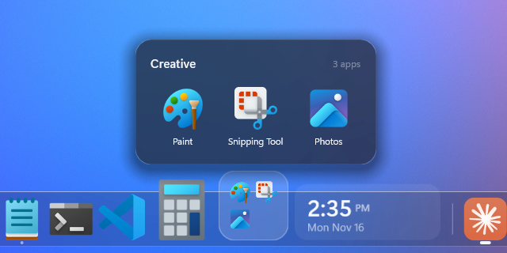</td>
<td width="50%">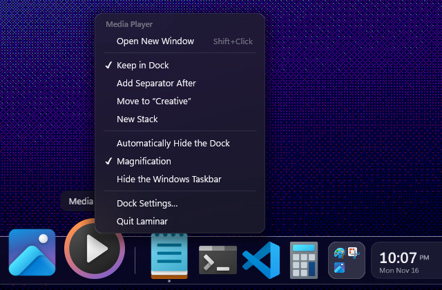</td>
</tr>
<tr>
<td><b>Stacks.</b> Drag one app onto another and hold to make a stack. Rename it, reorder it, and open it as a glass grid.</td>
<td><b>Menus that match.</b> Glass right-click menus with keyboard navigation, checkmarks and shortcuts.</td>
</tr>
</table>

- **Live previews.** Hover a running app to see thumbnails of its windows, even minimised ones. Close a window right from its preview.
- **Drag and drop.** Drop files on an app to open them with it, or on the Recycle Bin to delete them (undoable). Drag a file over a dock icon and hold, and that app's window comes forward so you can drop the file into it.
- **Attention dots.** When Slack, Teams or Outlook flash for attention, a soft green dot pulses under the icon. An auto-hidden dock peeks up so you notice.
- **Auto-hide or always visible**, on every monitor, with each display showing all apps or only its own windows.
- **Your tray apps, still there.** Laminar hosts the system tray, so PowerToys, Tailscale, Telegram and the rest keep working in Launchpad's Background Apps panel.

### Launchpad: Start menu, search and control centre in one

Press the **Windows key** on its own (all the Win+ shortcuts still work). One glass screen gives you widgets on the left, apps and search in the middle, and quick controls on the right.

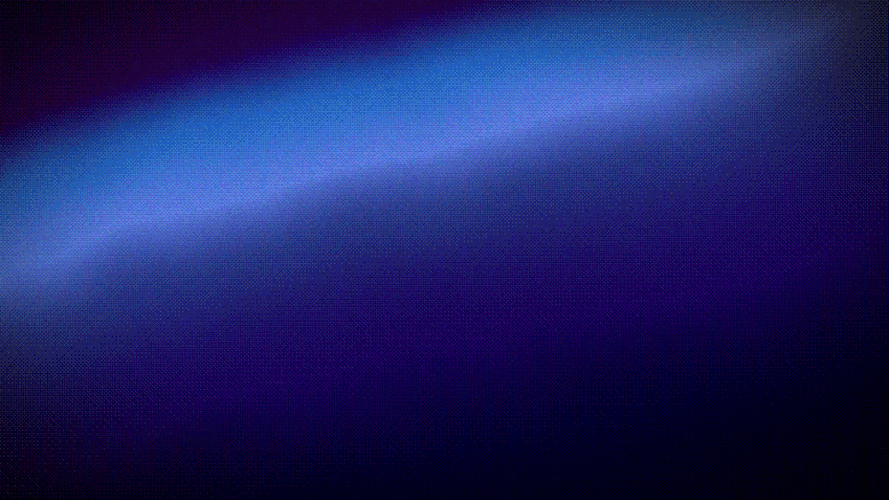

### Search that understands Windows

Type anything. Laminar knows about **1,350 Windows settings** (with Windows' own synonyms, so `blue light` finds Night light) and 140 Control Panel tasks. It also does maths, converts units, tells the time in other cities and runs commands. It learns which result you pick for what you type, and most searches finish in 1–2 ms.

<table>
<tr>
<td width="55%">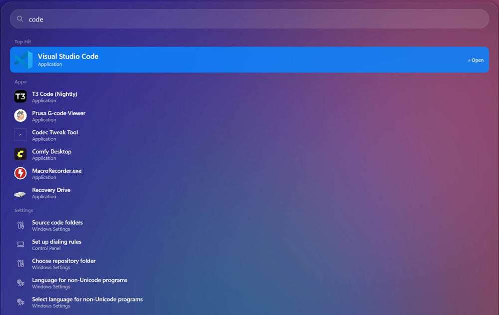</td>
<td>

| Type | Get |
| --- | --- |
| `night light`, `vpn`, `mouse speed` | That exact Windows setting |
| `15% of 80`, `sqrt(2)` | The answer; Enter copies it |
| `5 km in miles`, `70 f to c` | Unit conversions |
| `time in tokyo` | Local time and offset |
| `bluetooth`, `dark mode`, `volume 30` | Toggles and commands |
| `g rust`, `yt lofi`, `gh laminar` | Search that site |
| part of a window title | Jump to that window |

</td>
</tr>
</table>

### 100+ widgets, in Launchpad or right in the dock

Clocks, weather, calendar, system monitors, timers, stocks, crypto, GitHub activity, AI usage and spend, revenue and analytics dashboards. Drag them to arrange them, resize them, or put a compact version in the dock. API keys are kept in **Windows Credential Manager**, never in a settings file, and are only sent to their own service.

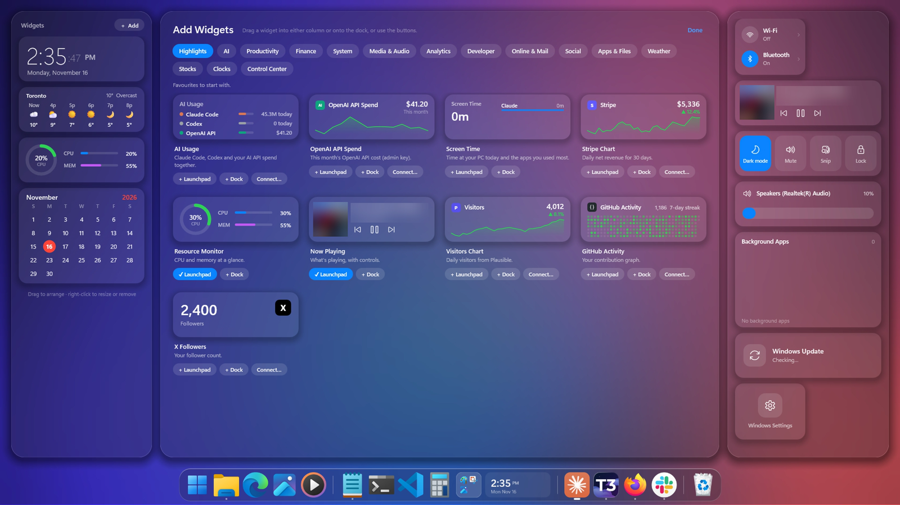

### Light, dark, and yours

Laminar follows Windows' light/dark mode as it changes. Icon size, magnification, spacing, corner radius, glass tint, blur, shadows and auto-hide timing are all live sliders.

<table>
<tr>
<td width="50%">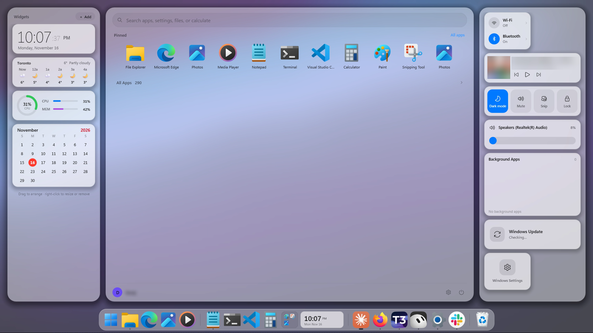</td>
<td width="50%">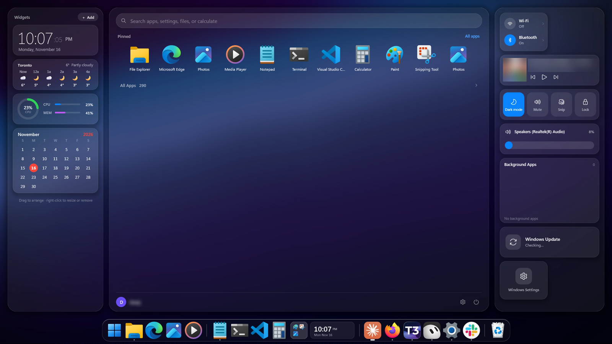</td>
</tr>
<tr>
<td colspan="2">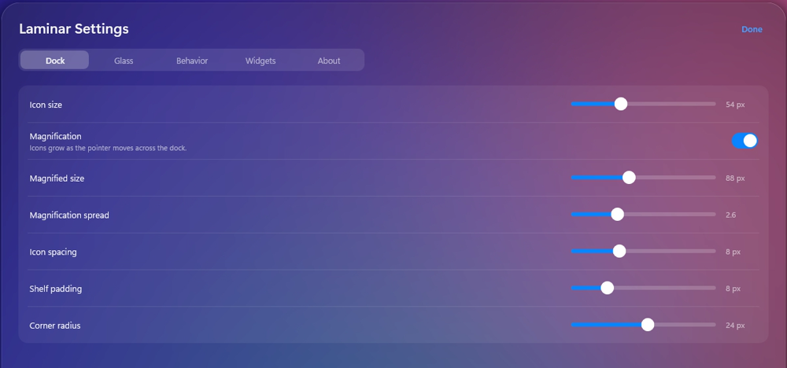</td>
</tr>
</table>

## 📦 Install

1. Download **[LaminarDock-win-Setup.exe](https://github.com/davesousa/Laminar_Dock/releases/latest/download/LaminarDock-win-Setup.exe)** (about 12 MB).
2. Run it. It installs for your user only (no admin needed), starts Laminar, and hides the Windows taskbar.
3. Press the **Windows key** to open Launchpad, or right-click the dock for settings.

Updates install themselves: Laminar checks GitHub once a day (or only at startup, or weekly; choose in Settings → About, or turn automatic checks off), downloads quietly, and shows a small green tile in the dock. Nothing installs until you click **Restart and Update**.

> [!NOTE]
> **"Windows protected your PC"?** The installer isn't code-signed yet, so SmartScreen warns about it. Click **More info → Run anyway**. One antivirus product (Avira) has flagged an earlier version as a false positive. The full source is here and every release is built by [GitHub Actions](.github/workflows/release.yml) from this repository, so you can check exactly what you're running.

**To remove it:** right-click the dock → **Quit Laminar** (the Windows taskbar comes straight back), or uninstall from **Settings → Apps**. Explorer is never replaced or modified, only its taskbar is hidden. If Laminar ever crashes, a tiny watchdog process brings the taskbar back.

## 🐞 Beta: what we know and what we need

This is a young project, so please expect bugs. These are the known gaps today:

| Area | Status |
| --- | --- |
| Hardware coverage | Tested on a few Windows 11 PCs. **Windows 10, ARM, laptops with odd scaling and unusual multi-monitor setups are untested.** |
| Code signing | The installer is unsigned, so SmartScreen and some antivirus tools are wary of it. |
| Service connectors | About 20 widget connectors (Stripe, Vercel, Linear, Plausible, YouTube and more) are built and unit-tested against sample responses but **haven't been tried with real accounts**. |
| Unread badges | Apps that draw a count on their taskbar icon (Slack's red number) don't show it in the dock yet. Only the attention flash is picked up. |
| Polish | Some widget layouts truncate text or leave empty space. Some running-app labels show the program file name (`slack.exe`) instead of the app name. |
| Not possible (yet) | Glass refraction over live windows (Windows' compositor refuses it), and Focus / Do Not Disturb (no public Windows API). |

**Found something?** [Open an issue](https://github.com/davesousa/Laminar_Dock/issues/new) and include:

- your Windows version (`winver`), and your display setup (how many monitors, and their scaling),
- what you did, what you expected, and what happened instead (a screenshot or a short screen recording helps a lot),
- your Laminar version (**Settings → About**).

## 🤝 Contributing

Pull requests are very welcome, from typo fixes to whole features. Good places to start:

- **Try a connector with your own account** (Stripe, Vercel, Plausible, YouTube and so on) and tell us whether it works, or fix it.
- **Test on hardware we don't have**: Windows 10, ARM, high-DPI laptops, three or more monitors.
- **Pick a bug** from [Issues](https://github.com/davesousa/Laminar_Dock/issues) or from the beta table above.
- **Design a widget.** Each one is a small Direct2D drawing in [`native/laminar/src/widgets/`](native/laminar/src/widgets/).

### Build from source

You need Windows and [Rust](https://rustup.rs/). The exact toolchain is pinned in `rust-toolchain.toml`, and `rustup` installs it on the first build.

```bash
git clone https://github.com/davesousa/Laminar_Dock.git
cd Laminar_Dock
cargo build --release -p laminar
cargo test
```

Then run `target\release\laminar.exe`. A copy you built yourself never updates itself or touches your startup settings. Handy flags for development:

| Command | What it does |
| --- | --- |
| `laminar.exe --measure` | Starts a test dock beside your real one and prints idle CPU, memory and start-up time as JSON |
| `laminar.exe --demo launchpad` | Test dock that opens Launchpad straight away (also `lp-gallery`, `lp-settings`, `stack`, `menu`) |
| `laminar.exe --widget-sheet widgets.png` | Renders every widget at every size, with sample data, to one PNG |
| `LAMINAR_THEME=light` | Forces the light theme for testing |

### How it fits together

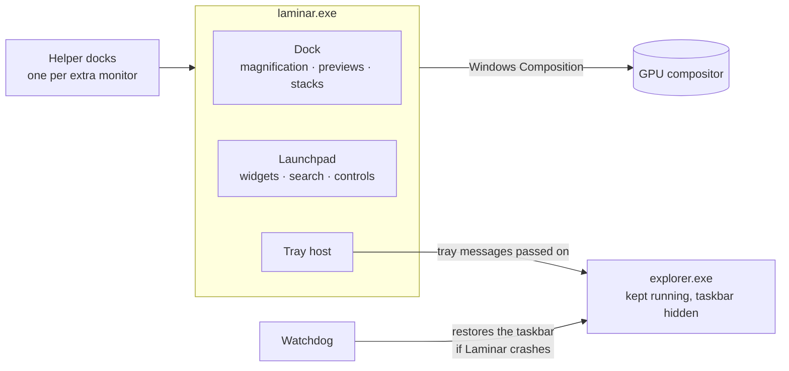

| Folder | What's inside |
| --- | --- |
| [`native/laminar/`](native/laminar/) | The app: dock, Launchpad, widgets, menus, settings, updater |
| [`native/laminar-sys/`](native/laminar-sys/) | Windows plumbing: apps, search, audio, media, Wi-Fi/Bluetooth, weather, service connectors |
| [`prototype/`](prototype/) | The original HTML/CSS design prototype where the look and motion were worked out |
| [`docs/DEVELOPMENT.md`](docs/DEVELOPMENT.md) | The full development log: every decision, test round and measurement |

Built with [`windows-rs`](https://github.com/microsoft/windows-rs) (Direct2D, DirectWrite and `Windows.UI.Composition`), and [Velopack](https://velopack.io/) for installs and updates. Tray hosting follows the approach used by [Cairo](https://github.com/cairoshell/cairoshell) and [RetroBar](https://github.com/dremin/RetroBar).

## ❓ FAQ

<details>
<summary><b>Is this a skin for the Windows taskbar?</b></summary>
<br>
No. Laminar is its own app that draws its own dock and Launchpad. It keeps Explorer running (so File Explorer, the desktop and system dialogs all work as usual) and only hides Explorer's taskbar while Laminar runs.
</details>

<details>
<summary><b>What happens if it crashes?</b></summary>
<br>
A separate watchdog process (about 1 MB) notices and brings the Windows taskbar back, so you're never left without one.
</details>

<details>
<summary><b>Does it collect any data?</b></summary>
<br>
No. There is no telemetry. Laminar only goes online to check GitHub for updates, to fetch the weather, and to fetch data for widgets you add (such as stocks, or a service you connect yourself). Web searches you type open in your own browser.
</details>

<details>
<summary><b>Will it use Apple's icons or fonts?</b></summary>
<br>
No. Laminar follows the <i>principles</i> of good macOS design, but its icons and graphics are original, and it uses Windows' own Segoe UI Variable font.
</details>

## 📄 License

[MIT](LICENSE): free to use, change and share. If Laminar makes your desktop nicer, a ⭐ helps other people find it.

<div align="center">
<sub>Made with Rust and too much attention to animation curves.</sub>
</div>
